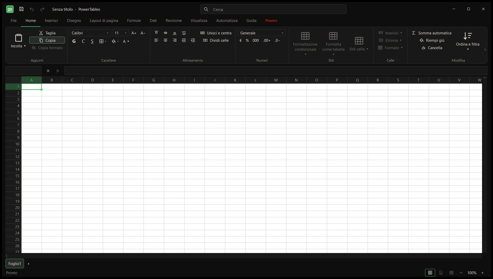
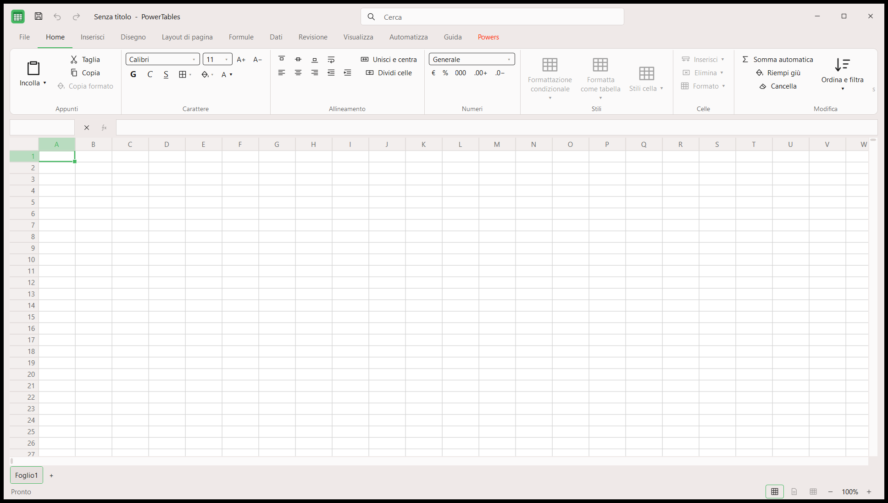
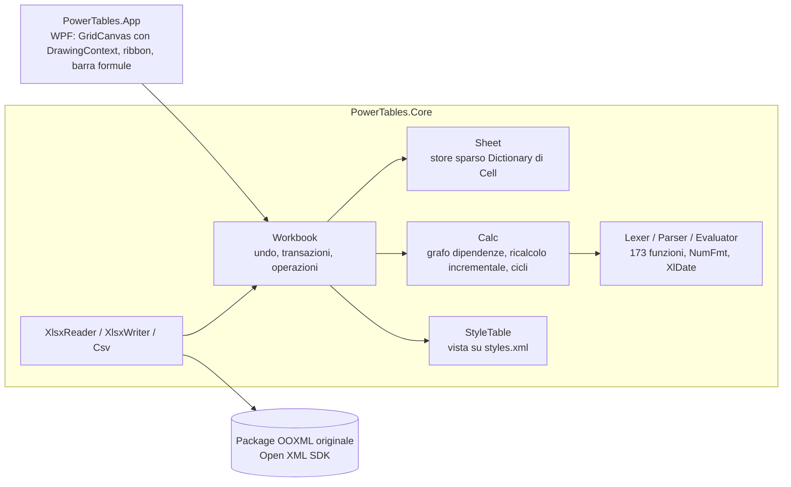

# PowerTables

Foglio di calcolo open source (MIT) per Windows 10/11 x64, scritto in C# / .NET 10 / WPF. Formato nativo `.xlsx` (ECMA-376), interfaccia originale con tema scuro (predefinito) e chiaro, accento `#3ecf8e`.




## Stato

P0 completato per quanto indicato in [FEATURES.md](FEATURES.md); misure e confronti reali in [COMPAT.md](COMPAT.md).
In breve: 42 file prodotti da Excel vero → apri/salva/riapri in Excel senza ripristino, parti XML identiche senza modifiche, modifiche verificate in Excel; motore formule con 173 funzioni
(393 formule confrontate con Excel vero, tutte uguali); test con 1.000.000 di righe popolate (apertura 7,7 s, scroll 11–32 ms per fotogramma, ricalcolo completo 6,8 s su 2 milioni di formule).
Non completati: vedere le voci non spuntate in FEATURES.md (grafici/immagini conservati ma non visualizzati, stampa/PDF, inserimento righe/colonne, ecc.).

## Compilare e avviare

```
dotnet build PowerTables.sln -c Release
src\PowerTables.App\bin\Release\net10.0-windows\PowerTables.App.exe [file.xlsx]    # --light per il tema chiaro
dotnet test                                    # tutti i test (usano Excel desktop via COM se installato)
dotnet test --filter "Category!=OfficeCom&Category!=Load&Category!=Ui"   # solo i test senza Excel
```
Strumenti in `tools/`: `make-corpus.ps1` (rigenera il corpus con Excel vero), `excel-batch.ps1` / `excel-dump.ps1` (apertura in Excel, rilevatore di errori/ripristino, dump invariante con `Formula`/`Value2`),
`inventory-ribbon.ps1` (inventario del ribbon), `screenshot-app.ps1`. Gli script avviano un'istanza Excel privata e nascosta, la chiudono sempre e terminano al più il proprio PID.
Benchmark: `PowerTables.App.exe --bench <file.xlsx> <out.json>` (il file da 1M righe si genera con il test `Category=Load`).

## Architettura



Scelte principali:
- **Round-trip**: il package originale resta aperto; al salvataggio si riscrivono solo le righe/parti toccate (`styles.xml`, righe sporche, `<cols>`/unioni/riquadri/filtri se modificati), il resto è copiato invariato; `calcChain` viene rimossa solo se cambiano formule. Salvataggio atomico.
- **Griglia**: un solo `FrameworkElement` che disegna le celle visibili; metriche di righe/colonne con somme prefisse sparse; scorrimento in pixel; riquadri bloccati in quattro quadranti.
- **Formule**: salvate in forma invariante OOXML (virgola, nomi inglesi, prefisso `_xlfn.` dove serve); la UI accetta la stessa sintassi. Le formule che il motore non sa valutare mantengono formula e valore in cache.
- Scorciatoie deliberate sono marcate nel codice con `ponytail:` e il limite relativo.

## Licenza
MIT, vedere `LICENSE`; dipendenze in `THIRD_PARTY.md`.
